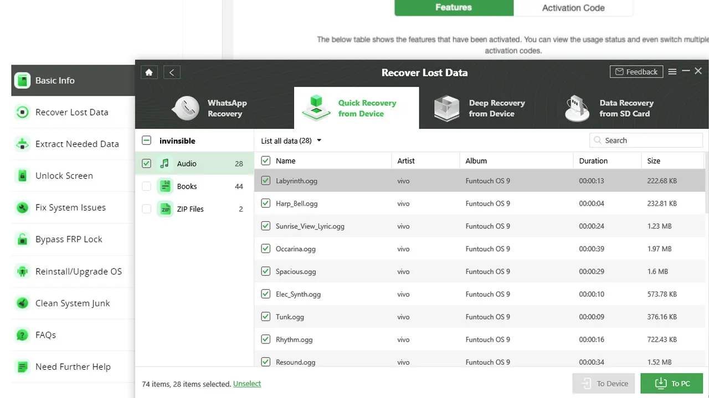
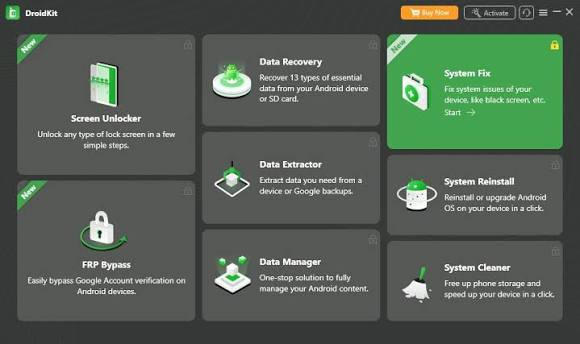

# DroidKit Maps Android Problems to Recovery Choices

A phone that starts normally, a readable memory card, and a device stuck at its logo offer different ways to reach data.
DroidKit groups recovery, extraction, data management, and repair into a desktop toolkit.
Choose the source you can actually access before selecting an operation.

## Decide What Must Survive the Next Step

Start with the outcome: retrieving a missing file, copying existing content, or making the phone usable again.
Repairing Android and recovering a photograph are different objectives.
If the files matter most, evaluate available copies before choosing a procedure that can reset the device.

| Available source | DroidKit route to examine | Access condition | Result to verify |
| --- | --- | --- | --- |
| Running Android phone | Quick Recovery | Device connection accepted by the module | Previewed items exported successfully |
| Internal storage needing a deeper scan | Deep Recovery | Root and device compatibility requirements | Recoverable content, without a success guarantee |
| Removable SD card | SD Card Recovery | Supported card readable by the computer | Files saved to another drive |
| Existing content on an accessible phone | Data Manager | Supported connection and content category | A usable computer copy |
| Phone with a system fault | System Fix | Exact model supported by that module | Repair consequences and device startup |

DroidKit runs on Windows and macOS, while individual modules can have narrower availability.
Use the feature-specific instructions rather than treating the product's overall device list as a promise for every operation.
The [official overview](https://www.imobie.com/droidkit/) links the available modules and compatibility information.

[](https://droidkit-gratis.github.io/iMobie-DroidKit/)

## Preview Phone Data Before Choosing a Deeper Scan

Quick Recovery is the initial option to examine when the phone can participate in the supported connection workflow.
The [recovery documentation](https://www.imobie.com/droidkit/android-data-recovery.htm) distinguishes Quick Recovery without root from Deep Recovery that roots the device.
A deeper scan changes the access requirements; it does not guarantee that missing content still exists.



Choose a small set that you can recognize:

- A photograph with identifiable detail.
- A contact with more than one field.
- A conversation with a known date, if supported by the selected mode.
- A document that opens in its usual application.
- A video whose playback can be checked beyond its first frame.

Preview what is available and export a representative selection to the computer.
Open the exported results before assessing the rest of the scan.
A thumbnail or listed name alone does not establish that the complete item is usable.

### Keep the source and its metadata together

Backup software often records which parts of an application were captured.
Neo Backup's supplied database schemas include fields for package identity, backup dates, and content categories.
Those records help explain why an APK, application data, and shared media are different backup components.

Early combined schema snapshots are [1.json](schemas/com.machiav3lli.backup.data.dbs.DB/1.json), [2.json](schemas/com.machiav3lli.backup.data.dbs.DB/2.json), and [3.json](schemas/com.machiav3lli.backup.data.dbs.DB/3.json).
Further snapshots are [4.json](schemas/com.machiav3lli.backup.data.dbs.DB/4.json) and [5.json](schemas/com.machiav3lli.backup.data.dbs.DB/5.json).
They describe database structures, not recovered personal files.

The supplied [FAQ.md](FAQ.md) explains Neo Backup's backup parts and root requirements.
Use the distinction when recording what a separate backup contains.
An application package by itself is not a complete copy of the application's private state.

## Recover from a Card Without Filling It Again

DroidKit's [SD card module](https://www.imobie.com/droidkit/deleted-formatted-sd-card-recovery.htm) scans a card connected to the computer.
The published page identifies FAT16, FAT32, and exFAT support and marks this module as Windows-only.
Check the current page before planning the same workflow on a Mac.

Select the correct card by its capacity and identity.
Choose an output folder on a different drive with sufficient space.
Avoid saving the recovered collection back onto the source card.



A useful first pass is a recognizable group of photos or documents.
Check full-size images, document readability, and video playback.
Keep the successful export while evaluating whether another scan mode finds additional material.

### Package a completed export for safekeeping

After recovery finishes, Python can place a completed export folder into a ZIP archive.
Use an existing source directory and a new archive name outside that directory.

```python
from pathlib import Path
from shutil import make_archive

source = Path("recovered-card-files").resolve()
archive = Path("card-recovery-copy.zip").resolve()
if archive.exists():
    raise FileExistsError(archive)
print(make_archive(str(archive.with_suffix("")), "zip", root_dir=source))
```

Python documents this function in its [archive operations reference](https://docs.python.org/3/library/shutil.html#archiving-operations).
The ZIP packages the exported files; it does not scan the card again.
Open a sample from the archive and keep another copy on separate storage.

Neo Backup's [TROUBLESHOOTING.md](TROUBLESHOOTING.md) discusses missing or damaged backup properties.
Its [NOTES.md](NOTES.md) covers technical details including backup layout and scheduled work.
Both illustrate why preserving the associated metadata matters when keeping an application's own backup format.

## Copy Accessible Content Before a Repair

When the phone still allows access, use the [Data Manager](https://www.imobie.com/droidkit/android-data-manager.htm) to examine supported content transfers.
Copy a meaningful selection to the computer and check it there.
Do this before choosing a repair operation that may reset the device.

For a **droidkit android** workflow, separate ordinary file access from deleted-data recovery.
A visible camera folder contains accessible files.
Copying it does not recover deleted entries or automatically include private application databases.

With Android Platform-Tools installed and one authorized USB-debugging device connected, ADB can copy an accessible camera folder.
Choose a fresh local destination for this example.

```bash
adb pull /sdcard/DCIM ./phone-camera-copy
```

The [Android ADB reference](https://developer.android.com/tools/adb) documents file copying with pull.
The path must exist and be readable on the selected device.
Authorization is required; this command does not provide access to a locked or unauthorized phone.

### Distinguish a backup's format from its age

Keep the tool name and version with an existing backup.
Neo Backup's combined database snapshots continue through [6.json](schemas/com.machiav3lli.backup.data.dbs.DB/6.json), [7.json](schemas/com.machiav3lli.backup.data.dbs.DB/7.json), and [8.json](schemas/com.machiav3lli.backup.data.dbs.DB/8.json).
Later numbered snapshots include [9.json](schemas/com.machiav3lli.backup.data.dbs.DB/9.json), [10.json](schemas/com.machiav3lli.backup.data.dbs.DB/10.json), and [11.json](schemas/com.machiav3lli.backup.data.dbs.DB/11.json).

A schema version identifies a database layout.
It is not a count of saved applications or a measure of recovery quality.
Neo Backup's [ISSUES.md](ISSUES.md) also records application-specific restore limitations, including keystore-related behavior.

### Work with an existing Android AB backup

Android Backup Extractor handles backups already produced in Android's AB format.
With its installed abe wrapper and an existing unencrypted backup, this example creates a TAR output.

```bash
abe unpack phone-before-repair.ab phone-before-repair.tar
```

The [extractor README](https://github.com/nelenkov/android-backup-extractor#usage) documents unpacking and password handling.
Use a working copy of the AB file and an unused output name.
The command converts an existing backup; it neither scans the phone nor creates a new device backup.

## Treat Repair and Access Removal as Separate Decisions

System Fix addresses supported system faults such as boot loops and startup failures.
Its [official module page](https://www.imobie.com/droidkit/android-system-repair.htm) lists supported device families and explains that repair can require resetting the device.
Confirm the exact model and the displayed consequences before beginning.

A phone appearing in the general compatibility list is not sufficient evidence for a particular repair.
Read the module's requirements for that model and Android version.
Keep the computer powered and maintain the required connection during the instructed operation.

Screen Unlocker and FRP removal serve different purposes from file recovery.
The official FAQ states that FRP removal erases device data and that screen-unlock data preservation depends on the supported model and method.
Account recovery and proof-of-ownership support remain relevant when access is the main problem.

Before choosing a reset or reinstall, record:

1. The device's full model identifier.
2. Its current Android version, if known.
3. Whether local data or only device usability is the priority.
4. Which backups and cloud copies have been checked.
5. The consequences stated by the selected operation.

A successful startup after repair does not establish that previously deleted files were recovered.
Assess device operation and recovered content separately.
If the phone cannot provide access, ordinary ADB copying is not a substitute for a supported extraction route.

## Keep Recovery Records Useful for the Next Attempt

Record the selected DroidKit module, source, output location, and representative files tested.
For a **droidkit imobie** search, connect the result to the official iMobie product and the specific function needed.
The phrase **droidkit pro** should not replace checking the current license and module entitlement.

A **DroidKit Gratis** search can lead to a trial offering.
Check which scanning, preview, export, and repair actions the current offer actually permits.
Use the current pricing and in-app entitlement details before assuming that a free installer includes every operation.

### Separate schedules, exclusions, and saved data

A backup plan can exist without a completed backup.
Neo Backup's older schedule schemas are [2.json](schemas/com.machiav3lli.backup.dbs.ScheduleDatabase/2.json), [3.json](schemas/com.machiav3lli.backup.dbs.ScheduleDatabase/3.json), and [4.json](schemas/com.machiav3lli.backup.dbs.ScheduleDatabase/4.json).
The same schema series includes [5.json](schemas/com.machiav3lli.backup.dbs.ScheduleDatabase/5.json), [6.json](schemas/com.machiav3lli.backup.dbs.ScheduleDatabase/6.json), and [7.json](schemas/com.machiav3lli.backup.dbs.ScheduleDatabase/7.json).
These files describe schedule records rather than completed backup payloads.

Exclusion records appear in [1.json](schemas/com.machiav3lli.backup.dbs.BlocklistDatabase/1.json) and [2.json](schemas/com.machiav3lli.backup.dbs.BlocklistDatabase/2.json) from the blocklist schema series.
Application notes and tags appear in [1.json](schemas/com.machiav3lli.backup.dbs.AppExtrasDatabase/1.json).
Check what was actually captured instead of relying only on an enabled schedule or a selected application.

### Preserve format and encryption information

Additional combined schema snapshots are [8328.json](schemas/com.machiav3lli.backup.data.dbs.DB/8328.json), [8330.json](schemas/com.machiav3lli.backup.data.dbs.DB/8330.json), [8332.json](schemas/com.machiav3lli.backup.data.dbs.DB/8332.json), and [8333.json](schemas/com.machiav3lli.backup.data.dbs.DB/8333.json).
Their table sets vary, making the originating application version useful context.
Do not edit a schema export to try to repair personal backup data.

Neo Backup's experimental decryption helper is described in [README.md](etc/decrypt/README.md).
Its [decrypt-all.py](etc/decrypt/decrypt-all.py) implementation uses the dependency listed in [requirements.txt](etc/decrypt/requirements.txt).
It is a password-based helper for that backup format, not an Android lock-removal method.

The supplied [CHANGELOG.md](CHANGELOG.md) records Neo Backup release changes.
Keep release information with a problem report when a backup is visible in one version but behaves differently in another.
For DroidKit, provide the module, model, observed error, and the last completed step.

## Related Search Terms

DroidKit Gratis, iMobie DroidKit, droidkit imobie, droidkit android, droidkit pro, android, backup-tool, android-backup, backup, adb, data-recovery, root, mirroring, recording, screen
